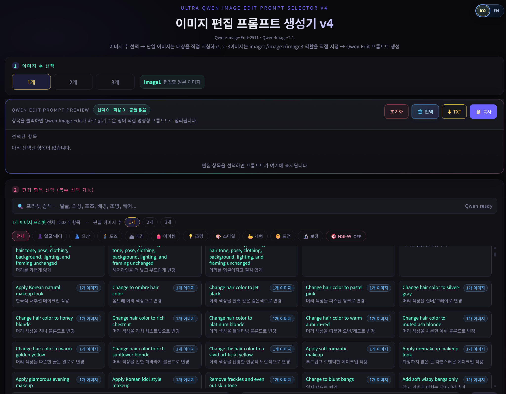
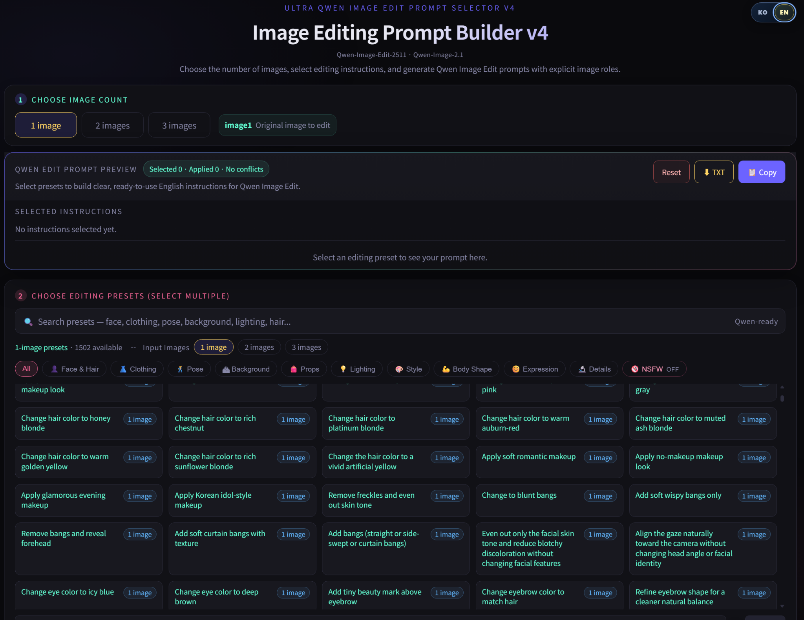
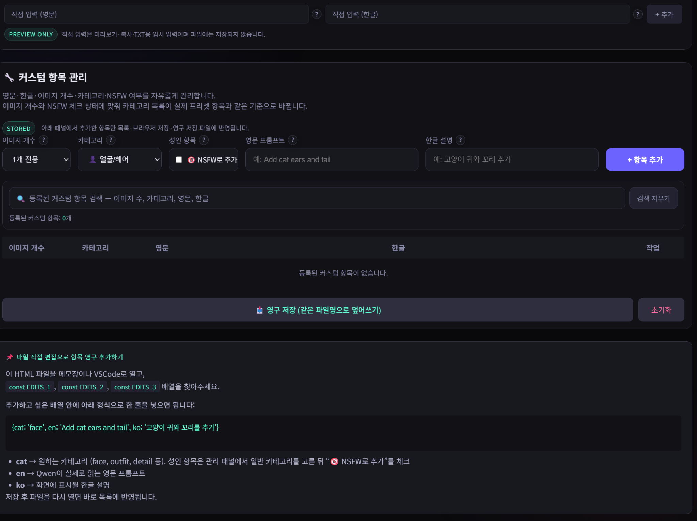
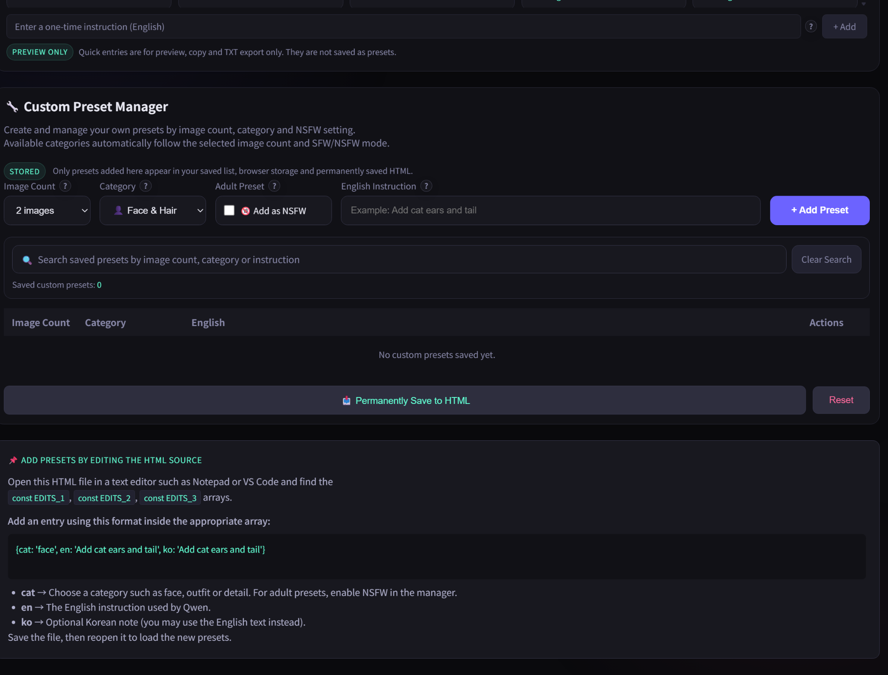

# Ultra Qwen Image Edit Prompt Selector v4

**한국어 · English** | **4,927 editing presets** | **1–3 input images** | **No installation**

Qwen 이미지 편집을 위한 **프롬프트 선택·조합 도구**입니다. 미리 준비된 4,927개 프리셋에서 원하는 편집 명령을 선택하고, 1~3장 이미지의 역할을 지정하여 **바로 복사해 사용할 수 있는 영어 편집 프롬프트**를 만듭니다. 한국어/영어 UI를 전환할 수 있으며, 하나의 HTML 파일을 브라우저에서 열어 사용합니다.

A standalone, browser-based **prompt builder for Qwen image editing**. Combine 4,927 ready-made editing presets, use clear `image1` / `image2` / `image3` references, and copy a structured English prompt into your image-editing workflow. Switch between Korean and English interfaces—no installation required.

**Designed for image-editing workflows using Qwen-Image-Edit-2511 and Qwen-Image-2.1.** This is a *prompt-writing tool*, not an image generator or a ComfyUI custom node. It does not download, run, or install AI models.

[한국어 안내](#-한국어-안내) · [English guide](#-english-guide) · [사용 설명서 / Manuals](#-사용-설명서--manuals)

---

## 🇰🇷 한국어 안내

### 앱 화면

**1. 한국어 UI — 프리셋 검색·선택 및 프롬프트 미리보기**

**2. 영어 UI — KO/EN 전환 시 한글 설명 없이 영어로 표시**

**3. 커스텀 항목 관리 — 나만의 편집 명령 추가·검색·관리**

### 주요 기능

- **4,927개 기본 프리셋:** 얼굴·헤어, 의상, 포즈, 배경, 소품, 조명, 스타일, 체형, 표정, 보정 등 다양한 편집 명령을 선택해 조합합니다.
- **1·2·3장 이미지 모드:** `image1`은 편집 대상 원본, `image2`와 `image3`은 참조 이미지로 사용합니다. 모드별 프리셋을 따로 제공합니다.
- **완성형 영어 프롬프트:** 단순히 선택 문장을 나열하는 대신, 이미지 역할과 유지 조건을 고려해 영어 편집 지시문을 구성합니다.
- **충돌 정리 및 상태 표시:** 서로 충돌하는 선택 사항을 확인하고, 실제 적용된 편집 명령을 미리 봅니다. 최종 프롬프트를 확인하고 사용하세요.
- **KO/EN 언어 전환:** 한국어 모드에서는 영문 프롬프트와 한글 설명을 함께 표시하고, 영어 모드에서는 한국어 설명을 숨깁니다. 언어 전환으로 프롬프트 내용은 달라지지 않습니다.
- **검색과 카테고리:** 한국어·영어 검색을 지원합니다. 일반 프리셋과 성인용(NSFW) 프리셋은 별도 선택으로 구분됩니다.
- **나만의 프리셋:** 커스텀 명령의 추가·수정·삭제, 브라우저 저장 및 HTML 파일에 영구 반영하는 기능을 제공합니다.
- **간편한 결과 활용:** 프롬프트 복사, TXT 저장, 직접 입력을 지원합니다. 한국어 모드에는 영문 프롬프트의 한국어 번역 기능도 있습니다(네트워크 연결이 필요할 수 있음).

### 사용 방법

1. [`Ultra_qwen_prompt_selecter_v4.html`](Ultra_qwen_prompt_selecter_v4.html)을 다운로드한 후 Chrome 또는 Edge에서 엽니다.
2. 상단에서 **KO/EN** 언어를 선택하고, 편집 워크플로우에 넣을 **이미지 수(1·2·3장)**를 정합니다.
3. 편집할 이미지의 순서를 맞춥니다. `image1`은 원본, `image2`·`image3`은 필요한 경우 참조 이미지입니다.
4. 검색 또는 카테고리로 프리셋을 선택하고, **프롬프트 미리보기**에서 최종 지시문을 확인합니다.
5. **복사** 또는 **TXT 저장**으로 영어 프롬프트를 가져와 Qwen 이미지 편집 워크플로우의 프롬프트 입력칸에 붙여 넣습니다.

> **중요:** 이 앱은 프롬프트 텍스트만 생성합니다. 실제 이미지 편집에는 Qwen 지원 모델, 이미지 입력 및 실행 가능한 별도 워크플로우가 필요합니다. 앱의 이미지 번호와 워크플로우의 입력 이미지 순서가 일치해야 합니다. Qwen-Image-2.1도 이 앱에서는 **이미지 편집 작업**을 위한 프롬프트를 작성하며, 앱이 지원하는 명시적 이미지 역할은 **최대 3장**입니다.

**한글 전체 설명서:** [`Ultra_qwen_prompt_selecter_v4_메뉴얼.txt`](Ultra_qwen_prompt_selecter_v4_메뉴얼.txt) — 이미지 역할, 실전 조합 예시, 프리셋 충돌, 커스텀 관리, 저장 및 문제 해결까지 상세 안내합니다.

---

## 🇺🇸 English guide

### Screenshots

**1. English interface — browse presets and build an editing prompt**

**2. Korean interface — bilingual descriptions available with KO selected**

**3. Custom preset manager — create and organize your own instructions**

### Features

- **4,927 built-in presets** for face and hair, clothing, pose, backgrounds, props, lighting, styles, body shape, expressions, refinements, and more.
- **Dedicated 1-, 2-, and 3-image modes.** `image1` is the source to edit; `image2` and `image3` supply visual references when needed.
- **Ready-to-use English prompts.** Combine editing actions into clear directions with explicit image roles and preservation cues instead of manually writing every instruction.
- **Conflict handling and preview.** Inspect selected and applied instructions before copying the final prompt. Conflicting options may be resolved automatically.
- **Korean / English interface.** Switch between languages without changing your selected presets or the English prompt output. English mode omits Korean descriptions.
- **Bilingual preset search** plus browsing by editing category and optional NSFW preset filtering.
- **Reusable custom presets.** Add, edit, delete, and search custom instructions. Keep them in browser storage or use the permanent HTML save function for a portable copy.
- **Copy or export.** Copy the final prompt, save it as a TXT file, and add temporary direct instructions. Korean mode also offers optional English-to-Korean prompt translation.

### Quick start

1. Download [`Ultra_qwen_prompt_selecter_v4.html`](Ultra_qwen_prompt_selecter_v4.html) and open it in a recent version of **Chrome or Edge**.
2. Select **EN** and choose **1 image**, **2 images**, or **3 images** to match your image-editing workflow.
3. Supply images in the intended order: `image1` = original to edit, `image2` / `image3` = references when applicable.
4. Search or browse editing presets. Select one or more and review the generated **prompt preview**.
5. Click **Copy** or **TXT**, then paste the English instructions into the prompt field of your compatible Qwen editing workflow.

> **Please note:** This application generates **prompt text only**; it does not run a model or edit images. Qwen-Image-2.1 supports image creation and editing, but this tool targets the **image-editing** use case. The app's presets explicitly cover **one to three input images**. Actual results depend on the model and workflow, and reference-image order matters.

**Complete English manual:** [`Ultra_qwen_prompt_selecter_v4_Manual_EN.txt`](Ultra_qwen_prompt_selecter_v4_Manual_EN.txt) — detailed chapters on image preparation, practical combinations, preset conflicts, NSFW filtering, custom presets, permanent saving, and troubleshooting.

---

## 📘 사용 설명서 / Manuals

| File | Contents |
|---|---|
| [`Ultra_qwen_prompt_selecter_v4.html`](Ultra_qwen_prompt_selecter_v4.html) | Standalone browser application / 실행용 단일 HTML |
| [`Ultra_qwen_prompt_selecter_v4_메뉴얼.txt`](Ultra_qwen_prompt_selecter_v4_메뉴얼.txt) | 전체 한글 사용 설명서 / Korean manual |
| [`Ultra_qwen_prompt_selecter_v4_Manual_EN.txt`](Ultra_qwen_prompt_selecter_v4_Manual_EN.txt) | Complete English user manual / 영문 설명서 |
| [`assets/`](assets/) | README screenshots / 소개 이미지 |

### Compatibility and notes / 호환성 및 주의사항

- **Supported prompt targets:** Qwen-Image-Edit-2511 and Qwen-Image-2.1 image-editing workflows. Other compatible Qwen image-editing models may interpret prompts differently.
- **Runs in your browser:** no installer, backend server, ComfyUI startup, or model download is needed to *write* prompts. Actual editing requires an appropriate external workflow.
- **Presets are not model weights:** this repository does **not** bundle Qwen models, ComfyUI custom nodes, or image-generation software.
- **Back up your HTML file** before using Permanent Save. Browser storage and saved HTML files are separate places for custom presets.
- **NSFW filtering:** disabled by default; enable it only when the intended workflow and local rules permit the content.

---

**Ultra Qwen Image Edit Prompt Selector v4** · Korean / English bilingual edition
